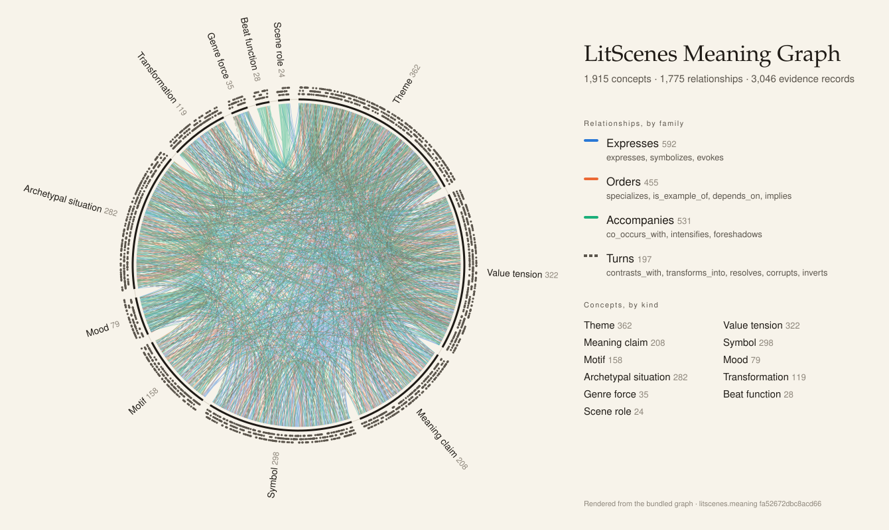

# LitScenes

A free, open-source macOS app for stories longer than a prompt. Built with Aloha by [Oʻahu A.I.](https://oahu.ai).

https://github.com/user-attachments/assets/0c371be6-f1b8-4f61-ad32-45be4e5ae80b

## A letter from the maker

I built LitScenes because I wanted to make videos that hold together as stories — across scenes, across characters, across whole projects. The app builds meaning and structure first; frames and renders follow from them.

LitScenes is a personal creative tool, and the code is yours to study and improve. It runs on your Mac with a complete, editable meaning graph and local projects. There is no LitScenes account or subscription. When you choose to generate, you use your own provider accounts and pay those providers for their usage.

If LitScenes helps you drive a good story into the world, I would be delighted. That is the point.

Kevin Riggen

## The meaning graph

Every story LitScenes helps you tell is drawn against one vocabulary: a graph of 1,915 concepts in eleven kinds, joined by 1,775 relationships and backed by 3,046 evidence records. It ships inside the app as editable YAML and compiles to a local SQLite cache. No service holds it.

<picture>
  <source media="(prefers-color-scheme: dark)" srcset="docs/media/meaning-graph-overview-dark.svg">
  
</picture>

The eleven kinds are the questions LitScenes asks of a frame, made into things you can name, inspect and connect:

| The question a frame is asked | Kind | For example |
| --- | --- | --- |
| What archetypal situation does it imply? | Archetypal situation | *Nowhere to Turn*, *Quest into the Unknown* |
| What symbols are active? | Symbol, Motif | *The Shared Key*, *Buried Light* |
| What value tension is present? | Value tension | *Justice versus mercy*, *Ownership vs. Custody* |
| What thought does it express? | Meaning claim | *An Ending Can Be Complete Without Explaining Everything* |
| What theme does it support? | Theme | *Shared Stewardship*, *Domestic Haven* |
| What transformation could it join? | Transformation | *From Doing For to Doing With*, *Hero to Tyrant* |
| What atmosphere does it carry? | Mood, Genre force | *Bittersweet Fullness*, *Comedy of Manners* |
| What beat should it serve? | Beat function, Scene role | *A Need Is Named*, *Passing On a Skill* |

Relationships are typed and directed: *expresses*, *symbolizes*, *evokes*, *specializes*, *depends_on*, *co_occurs_with*, *intensifies*, *foreshadows*, *contrasts_with*, *transforms_into* and five more. Each one carries a rationale. Here is one concept with everything it touches:

<picture>
  <source media="(prefers-color-scheme: dark)" srcset="docs/media/meaning-graph-neighborhood-dark.svg">
  
</picture>

That concept, as it is written in the bundled pack:

```yaml
- slug: theme.shared-stewardship
  kind: theme
  name: Shared Stewardship
  definition: People sustain something valuable through distributed responsibility rather than a single heroic owner.
  positive_expression: Handoffs, mutual correction, and a shared future.
  negative_expression: Responsibility dissolving because everyone assumes someone else will act.
  boundary: Concerns coordinated custody of a common good, not ownership disguised as generosity.
  editorial_rationale: Adds collective agency beyond solitary protagonists.
  provenance_kind: editorial_original
  abstraction_level: thematic
```

Most concepts are literary interpretations, with evidence that cites passages from eighteen public-domain works, *Frankenstein* and *Pride and Prejudice* among them. Two hundred and five are original editorial concepts like the one above, added so the graph can hold care, play, ordinary beauty, shared work, contemporary life and practical film grammar as well as it holds the Gothic. Every concept has a positive and a negative expression and a boundary, so a story can lean toward a meaning or away from it.

Relationships are interpretive possibilities, not rules. When you work on a story, the Goal interview receives a bounded choice packet from the graph, Scene Story receives at most six concepts and eight direct relationships, and your brief takes priority over all of it. Bibliographic evidence stays out of creative prompts. The exact provider-bound prompt and its outcome remain inspectable in Traces.

You can change any of this. Import your own YAML pack, layer a project overlay that adds, overrides or disables records without touching saved work, and preview the difference before applying it. [docs/meaning-graph.md](docs/meaning-graph.md) covers the pack format, overlays, the compiler and verification. The figures above are rendered from the compiled graph by [scripts/render_meaning_graph_figures.py](scripts/render_meaning_graph_figures.py), so they change when the graph does.

## What you can make

- **A story with a spine.** A Goal interview establishes the purpose, Frame Context grounds it in your material, Scene Stories organize the action, and Frame Forms develop concrete frames.
- **Scenes, shots and cuts.** Arrange footage and generated frames, shape trims, seams, loops, narration and sound, then assemble and export locally.
- **A personal visual language.** Browse 26 bundled starter styles, use your own reference images, and keep recurring people and places coherent across scenes.
- **A portable scene.** **Export Scene…** writes a folder with a composite image, the ordered frames, an optional playback MP4 and `scene.json` / `catalog.json` metadata. It contains no prompts, credentials, traces or original file paths, and it does not upload anything.
- **Your own workspace.** Projects, media, credentials and inference traces live on your Mac. No telemetry, account service, catalog service or hosted database is required. Provider requests use your configured accounts; graph updates are an explicit GitHub download.

## Install

Requires macOS 15+, Swift 6.1+ and a macOS 15+ SDK (Xcode 16.3+ or compatible Command Line Tools).

Download and inspect the installer from this repository:

```sh
curl -fSL https://raw.githubusercontent.com/litscenes/litscenes/main/scripts/install.sh -o litscenes-install.sh
less litscenes-install.sh
bash litscenes-install.sh
```

The [installer](scripts/install.sh) builds `~/Applications/LitScenes Development.app` without sudo. It preserves existing app bundles, projects and keys, and prints the source revision and retained build directory. Move an existing app aside before reinstalling.

Or build the checkout yourself:

```sh
git clone https://github.com/litscenes/litscenes.git
cd litscenes
swift build
swift test
scripts/build_litscenes_app.sh --channel development
open "dist/LitScenes Development.app"
```

Use the packaged app for media drag-and-drop and file associations. `swift run LitScenes` is also useful for a quick look. Local builds are ad-hoc signed, not notarized release downloads; use macOS's Open action if it asks you to approve the app.

Development builds keep projects in `~/Library/Application Support/LitScenes/`; Community builds use `~/Library/Application Support/LitScenes Community/`. There is no automatic app updater; published versions appear in [GitHub Releases](https://github.com/litscenes/litscenes/releases).

## Providers and keys

Open **Settings → API keys**. Start with OpenAI for media analysis and story work; add FAL for its image/video routes or ElevenLabs for voice. **Advanced providers** holds additional keys, compatible text endpoints, and model overrides. The app ships without credentials.

| Provider | Use |
| --- | --- |
| OpenAI or a compatible text endpoint | Analysis, stories and text; OpenAI image generation |
| FAL | Image and video generation |
| Stability | Image generation |
| ElevenLabs | Voice |
| Kling, LTX, Decart | Video generation |
| CivitAI | Image and video recipes |

Generation is optional and billed directly by your selected providers. Local browsing, editing, graph lookup and export need no key at all. Keys are stored in `credentials.env` with owner-only permissions, or supplied through the process environment.

## Contributing

LitScenes is beta software. Reproducible bug reports and ideas are welcome in [GitHub Issues](https://github.com/litscenes/litscenes/issues). Pull requests wait on the contributor agreement described in [CONTRIBUTING.md](CONTRIBUTING.md). Security reports follow [SECURITY.md](SECURITY.md).

## License and identity

LitScenes Desktop is licensed under `AGPL-3.0-only`; aesthetic metadata retains its `CC-BY-SA-3.0` attribution and terms. The 26 generated starter previews are included under the repository license. Purchased reference composites, raw corpora and private operational history are not included. See [THIRD_PARTY_LICENSES.md](THIRD_PARTY_LICENSES.md).

The LitScenes name, logo and official-build identity remain reserved marks; modified distributions should follow [TRADEMARKS.md](TRADEMARKS.md). See [LICENSING.md](LICENSING.md) for the source and commercial licensing terms.
